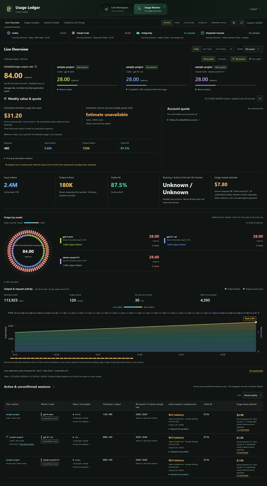
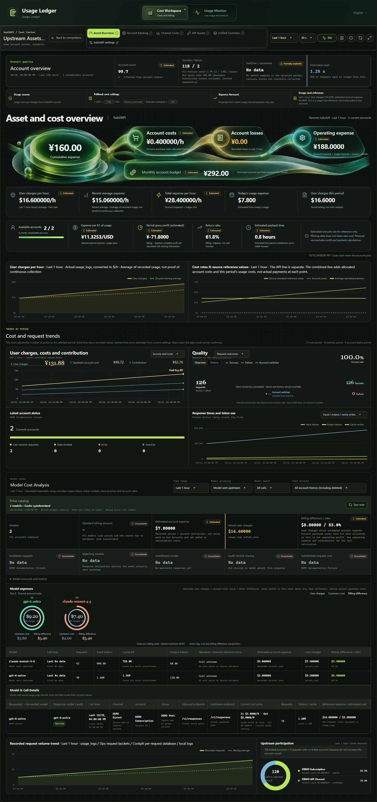

[English](README.md) | [简体中文](README.zh-CN.md)

# Usage Ledger

**Version 0.2.24 · AI usage monitoring and cost workspace · English / 中文**

Usage Ledger is a desktop app for understanding AI-tool activity and the cost of the accounts and services behind it. It combines a local usage monitor with a cost workspace for Sub2API, CLIProxyAPI, and Cockpit.

Use it to:

- Compare recorded tokens, cache usage, requests, and output rates across tools.
- Follow a session through its turns, requests, and linked subagents.
- Track account quota cycles without mixing them with calendar-week totals.
- Compare usage-based value with purchase costs, fees, refunds, and losses.
- Find missing records or prices before treating a total as complete.

Amounts calculated by Usage Ledger are estimates based on available usage, pricing, and your cost settings. They are not provider invoices or proof of payment.

[Source repository](https://github.com/9holy/usage-ledger) · [Chinese guide](README.zh-CN.md) · [Screenshot gallery](docs/screenshots/README.md)

## Get the App

Windows can be built from source using the instructions below. Mac test packages are provided through [Mac test builds](https://github.com/9holy/usage-ledger/actions?query=branch%3Atest%2Fmacos-free-20261026): open a successful run and download the artifact for your Mac's processor. GitHub may require sign-in to download artifacts. There are currently no stable installers on the [Releases page](https://github.com/9holy/usage-ledger/releases).

| Platform | Availability |
| --- | --- |
| Windows 10/11, x64 | Primary desktop target, using WebView2 and an NSIS installer build. |
| macOS 13+, Apple Silicon | Experimental build/test channel, separate from the Windows baseline. |
| macOS 13+, Intel | Experimental build/test channel, separate from the Windows baseline. |
| Linux | No supported desktop packaging instructions are provided here. |

The Mac test channel is maintained on [`test/macos-free-20261026`](https://github.com/9holy/usage-ledger/tree/test/macos-free-20261026), separate from the default Windows branch. Follow its [macOS guide](https://github.com/9holy/usage-ledger/blob/test/macos-free-20261026/docs/platforms/macos.md) for package selection and building instructions. Test packages use free ad-hoc signing, not Developer ID signing or notarization, so macOS may warn about their origin. Do not disable system security to bypass a warning. Some native window interactions and real-service workflows still need testing; back up important data before trying a test version.

## First Run

1. Launch the desktop app. Use the language selector at the top right to choose
   English or Chinese. Your selection is saved; the initial language can follow
   your system language.
2. Open **Usage Monitor** in the top workspace switcher to inspect local tool
   records. A remote connection is not required for local monitoring.
3. Open **Cost Workspace** to choose a saved service, add a connection, or open
   the local **Cockpit** source.
4. Check the selected period and source status before interpreting a number.
   New installations only show data the supported sources actually provide.
5. Enter your own purchase/cost information where appropriate. Default plan
   assumptions are a starting point, not confirmation of what you paid.

The desktop app does not bundle Sub2API, CLIProxyAPI, Cockpit, or a cost-service backend. Install or run the services you intend to connect separately.

On Windows, closing the main window hides it to the system tray while collection continues. Use the tray menu to reopen a workspace or choose **Quit Usage Ledger** to stop the app.

## Find Your Way Around

| View | What to use it for |
| --- | --- |
| Live Overview | Recorded output rates, tool/model activity, account periods, quotas, and current sessions. |
| Usage Analysis | Period totals, cache composition, model rankings, reference costs, and pricing coverage. |
| Session Details | Session families, subagents, turns, individual requests, timing, and source identifiers. |
| Collection & Pricing | Discovered sources, collection failures, retained history, and pricing catalog status. |
| Asset Overview | Account availability, operating expense, usage value, and cost/request trends. |
| Account Ranking | Compare accounts over the selected period and inspect their cost settings. |
| Channel Costs | Account-pool costs and source-specific cost assumptions. |
| API Access | Source-specific endpoints, client configuration, and available diagnostics. |
| Unified Summary | Compare selected Sub2API, CLIProxyAPI, and Cockpit readings for the same period. |
| Cost Ledger | Record purchases, renewals, refunds, adjustments, and termination losses. |
| Data Management | Inspect source health, history boundaries, and retention/maintenance controls. |

Not every source supplies every field or management action. Opening Unified Summary does not create missing data or automatically connect three services.

| Local usage monitor | Cost workspace |
| --- | --- |
|  |  |

Fictional DEMO data. [All 14 views in English and Chinese](docs/screenshots/README.md).

## Connect a Data Source

### Sub2API

1. Choose **New connection**, give it a name, and select **Sub2API**.
2. Enter the service base URL, for example `https://gateway.example.invalid`.
   This is the Sub2API service address, not an OpenAI-compatible `/v1` endpoint.
   The app adds `/api/v1`; an address already ending in `/api/v1` is accepted.
3. Choose **Admin API key**, or **Email and password** for a permitted account.
   An ordinary inference API key is not a substitute for an admin API key.
4. Select **Save and connect**. If sign-in requires two-factor authentication,
   enter the code in the app.
5. Leave **Separate cost service URL** blank unless your deployment has a
   separate service supporting the economics/cost-loss endpoints.

**Remember password** allows automatic sign-in after a login expires. Turn it off when you do not want the password retained on this device. A saved login can still retain its session token. Remote permissions and the server's available endpoints determine which account/cost views can load.

### CLIProxyAPI

1. Start your CLIProxyAPI instance and make its management API available.
2. Choose **New connection** and select **CLIProxyAPI**.
3. Enter its service base URL. Leaving it blank uses `http://127.0.0.1:8317`.
4. Enter the original `remote-management.secret-key` from your instance's
   `config.yaml`, not its encrypted/hashed form and not a client inference key.
5. Select **Save and connect**.

The management API uses `/v0/management` with the management key as Bearer authentication. Client traffic uses endpoints such as `/v1/chat/completions` or `/v1/responses` and has a different purpose. Do not enter a client endpoint as the management service address.

Historical detail also depends on the available usage records, including the supported local CPA usage database when present. A reachable management API alone does not guarantee complete historical token/cost data. The management page opens your connected CLIProxyAPI instance.

### Cockpit

On the connection screen, find **Cockpit** under **Local data** and select **Open cost workspace**. No service URL or management key is required.

Usage Ledger discovers supported data under `~/.antigravity_cockpit` in your user home. **Data available** means local data can be read, not that Cockpit's process is running. If the source is unavailable, install/use Cockpit and check the local data it has produced. The app does not manufacture replacement records.

### Switching and Removing Connections

Use **Back to connections** to select another saved service. Deleting a saved connection removes its local connection entry, not the upstream server's data. Keep keys, passwords, session tokens, and account files out of issues and chat.

## Local Tool Records

The monitor reads supported formats from **Codex**, **Claude Code**, **DeepSeek Harness**, and **Antigravity**. Support depends on the records your installed tool/version produces; it is not a guarantee that every metric exists.

Here `~` means the current user's home directory.

| Tool | Discovered records | Supported custom location |
| --- | --- | --- |
| Codex | `~/.codex/sessions` and `archived_sessions` | Also reads `CODEX_HOME` and Codex homes registered by Cockpit. |
| Claude Code | `~/.claude/projects` | Also reads `CLAUDE_CONFIG_DIR/projects`. |
| DeepSeek Harness | `~/.dsh/sessions` | `DSH_HOME/sessions` replaces the default home when set. |
| Antigravity | `~/.gemini/antigravity/brain`, `antigravity-ide/brain`, `antigravity-cli/brain` | Known local locations; no general custom-path picker. |

Set supported environment variables **before launching Usage Ledger**, then restart the app. The app inherits its own process environment, not changes made later in an unrelated terminal. Check **Collection & Pricing** for the paths and status actually discovered. These readers do not rewrite the original tool logs.

[DeepSeek Harness details](docs/integrations/deepseek-harness.md) cover supported session generations, compressed files, and unsupported-format errors. Antigravity discovery and local language-server metadata are best-effort and can change with the tool; missing metadata must not be interpreted as zero activity.

## Read the Numbers Correctly

### Tokens, Speed, and Prices

- Missing cache or reasoning fields remain unknown. Reasoning tokens are not an
  extra output bucket to add again to the output total.
- An output rate is an average over its recorded observation window. It may not
  equal the model's instantaneous streaming-generation speed.
- Requested model/mode and response-confirmed model/mode are separate evidence.
  Missing mode confirmation can prevent a definitive price estimate.
- Inspect the pricing coverage and price source. An unpriced request can still
  have valid token counts; a partial quoted total is not a complete bill.

### Quotas and Account Periods

Calendar-week usage, subscription-month usage, and a provider's weekly quota cycle are different views. A provider cycle follows the reported reset boundary, not necessarily Monday through Sunday.

A zero percentage alone does not prove that a new cycle started. At a confirmed 100% quota boundary, later extra-credit usage is kept separate from the included quota-cycle amount, while still contributing to the applicable month total.

Forecasts need the quota percentage and accumulated amount from the **same quota reading**, for the same account and cycle. When a matching reading is unavailable, the app may show the last valid estimate with its update time, or wait for a new reading. A forecast is not a promised final charge.

### Purchase Costs and Rates

Use **Cost Ledger** for financial events and the account cost controls for purchase amount, currency, billing cycle, and start date. Review the active account/source and coverage dates before saving.

Usage-based costs are calculated from available upstream usage plus the app's pricing/cost settings. Entered financial events, allocated subscription expense, remaining prepaid value, refunds, losses, and usage reference value are not the same quantity. A source's user charges are not automatically your procurement cost.

Check the currency, exchange rate, account multiplier, and period shown on the page. A manual exchange-rate override remains an assumption until you change or restore it. CLIProxyAPI and Cockpit do not acquire a Sub2API-style account multiplier merely because a comparison view contains that column.

In **Fallback Cost Settings**, the exchange rate converts USD/CNY amounts; it does not change token counts or original upstream charges. The estimate multiplier applies to default plan prices and usage-based reference estimates. Recorded purchases take priority for the periods they cover, and custom account purchase prices are not multiplied again. Available upstream account costs take priority for metered usage without another multiplier. Cockpit's reference cost estimates still use the multiplier; they are not actual payments.

### Unknown, Partial, and Historical States

**No data**, **unavailable**, **partial**, **estimated**, and **measured** have different meanings. A dash is not zero; a partial amount includes only the records that could be priced. An account appearing in history does not mean it is still available. When comparing figures, use the same source, account, currency, period, and available records.

## Data and Privacy

Usage collection reads supported upstream logs/databases and saves its own local ledger, collection progress, and account-period history. Financial entries, local-source cost settings, connection details, and UI preferences also persist locally; Sub2API cost profiles can be saved remotely.

- On Windows, the SQLite ledger normally uses `%APPDATA%/com.console.2api`, with
  legacy/fallback locations including `%APPDATA%/2api-console`.
- Local cost-profile JSON files use `%APPDATA%/2api-console` on Windows.
  The non-Windows fallback for app ledger/profile data is
  `~/.local/share/2api-console`.
- A configured `CONSOLE2API_LEDGER_DIR` changes the SQLite ledger location.
  Do not assume one directory contains all WebView preferences and credentials.
- Saved keys/passwords in connection storage are **obfuscated, not encrypted**.
  Protect your OS account and backups; this is not a credential vault.
- Back up important data with the app closed. Do not run duplicate app instances
  against the same data identity, or delete databases just to repair a display.

Monitoring does not modify original source logs, but the whole application is **not read-only**: saving a Sub2API cost profile updates that remote account; management/import actions can change configured services or local Cockpit files. Financial ledger entries and local Cockpit/CLIProxy cost profiles are app writes.

Configured services, pricing, exchange rates, updates, and explicitly requested checks can use the network. An upstream probe/model test can consume paid quota. Use those actions deliberately; opening a local monitor is not consent to make a paid test call. See the [privacy notes](docs/PRIVACY.md) for additional context.

## Troubleshooting

| Problem | What to check |
| --- | --- |
| Monitor is empty | Produce a supported tool record, check Collection & Pricing, and verify the home directory/environment inherited by the app. |
| A source is unavailable | Read its reason: absent files, unsupported formats, permissions, and an unreachable service are different problems. |
| Sub2API login fails | Check the service URL, admin permissions/auth mode, expired login, and any two-factor prompt. |
| CLIProxyAPI returns 401/403 | Use the original management secret and management base URL; verify the instance allows your connection. |
| Cockpit says Not installed | Check whether its expected local data exists for this OS user; a running process alone is insufficient. |
| Cost or quota is missing | Check matching account/cycle, timestamps, price coverage, and source fields; do not replace unknowns with zero. |
| Historical totals differ | Align the selected period and filters, and inspect missing/retained history and financial coverage. |
| Browser preview lacks local data | Local readers require the Tauri desktop host; Vite alone is not the full app. |
| Local desktop bridge cannot start | Check whether another app instance is already using the loopback service, including port `18765`. |
| OS warns about the package | Verify its origin/signature. Windows publisher signing and updater signatures are different; Mac test signing is not notarization. |

For a bug report, include the app version, OS/architecture, source type, selected period, visible error, and a minimal redacted example where possible. Do not attach an entire home directory, credential file, database, or raw private session log. Review screenshots for account names, email addresses, keys, and URLs.

## Build from Source

### Windows

Install Node.js 22 LTS or a compatible newer version, pnpm 9.15.9, Rust stable with the MSVC toolchain, Visual Studio C++ Build Tools, and WebView2 Runtime.

~~~powershell
git clone https://github.com/9holy/usage-ledger.git
cd usage-ledger
pnpm install --frozen-lockfile
pnpm desktop:dev
~~~

The desktop development URL is `http://127.0.0.1:5180`. For a local installer without updater-signature artifacts:

~~~powershell
pnpm build:desktop
pnpm exec tauri build --config src-tauri/tauri.local.conf.json
~~~

Frontend output is `dist/`; the native executable is `src-tauri/target/release/console2api.exe`, and NSIS installers are under `src-tauri/target/release/bundle/nsis/`. `pnpm desktop:build` uses the normal release configuration, whose updater artifacts need the maintainer's signing key. Windows may show **Unknown Publisher** without an Authenticode certificate.

### macOS Test Channel

Use a Mac, Xcode Command Line Tools, Node.js/pnpm, and Rust. Switch to the test branch **before** using its Mac-only scripts:

~~~sh
git clone https://github.com/9holy/usage-ledger.git
cd usage-ledger
git switch test/macos-free-20261026
xcode-select --install
rustup target add aarch64-apple-darwin x86_64-apple-darwin
pnpm install --frozen-lockfile
pnpm desktop:test:mac
pnpm desktop:build:mac
~~~

The build command creates a universal app/DMG by default; the [macOS guide](https://github.com/9holy/usage-ledger/blob/test/macos-free-20261026/docs/platforms/macos.md) also explains single-architecture targets and signing limitations. The default branch does not yet include these Mac scripts. Do not interpret a successful source build as validation of real accounts or every native UI flow.

## Documentation and Licensing

- [Full screenshot gallery](docs/screenshots/README.md): 14 views per language;
  all screenshots use fictional DEMO data, not real account statements.
- [DeepSeek Harness integration](docs/integrations/deepseek-harness.md).
- [macOS test-channel guide](https://github.com/9holy/usage-ledger/blob/test/macos-free-20261026/docs/platforms/macos.md).
- [0.2.24 release notes](docs/release/0.2.24.md).
- [Privacy notes](docs/PRIVACY.md).
- [Third-party notices](THIRD_PARTY_NOTICES.md) and [license texts](LICENSES/).

This is **not a blanket MIT project**. Sub2API-derived code retains applicable LGPL-3.0 terms; third-party icons, artwork, and dependencies retain their own licenses. Some assets have noncommercial/share-alike terms or no general reuse grant. Public source availability does not grant unrestricted commercial use or sublicensing of every component. Check the notices before redistributing.
