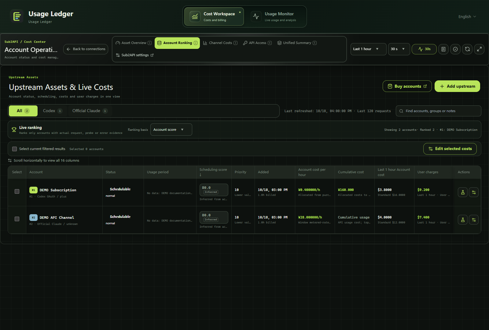
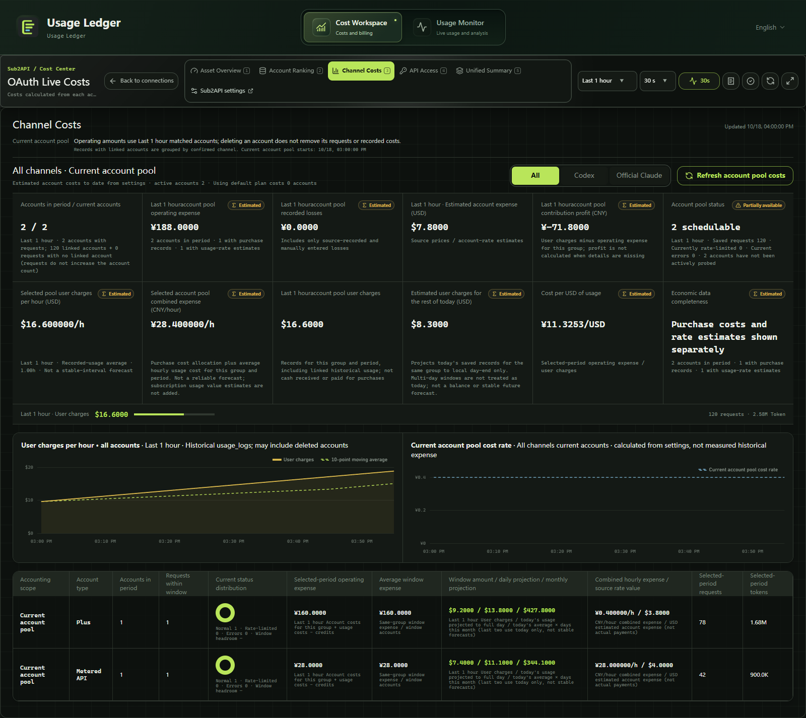

[English](README.md) | [简体中文](README.zh-CN.md)

# Usage Ledger

**Version 0.2.24 · Windows desktop**

Usage Ledger is a Windows desktop workspace for local AI-tool usage, sessions and subagents, model reference costs, and source-specific cost data from Sub2API, CLIProxyAPI, and Cockpit. The application supports English and Chinese.

Source repository: [9holy/usage-ledger](https://github.com/9holy/usage-ledger). Access requirements follow the repository's visibility. A source snapshot excludes Git history; preparing it does not publish an installer or change repository visibility.

## Platform status

| Platform | Status |
| --- | --- |
| Windows | Existing verified Windows target; its NSIS configuration is unchanged. |
| macOS | Source-adapted for a universal Apple Silicon (`arm64`) and Intel (`x86_64`) app/DMG, minimum macOS 13.0. Native build and runtime verification are pending. |

No macOS `.app` or `.dmg` is provided or claimed here, and no cloud CI workflow is configured or has been run. See the [macOS build and verification guide](docs/platforms/macos.md). This documentation update claims no new Windows regression counts.

## Workspaces

| Workspace | Contents |
| --- | --- |
| Live Overview | Output rates, model speed, requests, quotas, and sessions |
| Usage Analysis | Tokens, cache, model rankings, reference costs, and price coverage |
| Session Details | Sessions, subagents, turns, requests, and timing |
| Collection & Pricing | Collection status and pricing sources |
| Cost Workspace | Assets, accounts, channels, API, unified summary, finance, and data governance |

## Supported records

The monitor reads supported local record formats from Codex, Claude Code, Antigravity, and [DeepSeek Harness](docs/integrations/deepseek-harness.md). Missing, partial, derived, and measured states remain distinct; unknown values are not treated as zero. Reference costs are not provider invoices. Speed, subscription quotas, extra credits, and time windows have separate meanings.

## Screenshots

| Monitor overview | Cost overview |
| --- | --- |
|  |  |

| Upstream accounts | Channel costs |
| --- | --- |
|  |  |

Browse all 28 views, 14 per language, in the [screenshot index](docs/screenshots/README.md). Screenshots show the current 0.2.24 Vue components and fictional DEMO data, captured on 2026-10-26 (Asia/Taipei); the fixture clock is fixed at 2026-10-18. They are not real-account or accounting checks and do not establish visual approval of cost trends or request quality. The existing Windows DEMO gallery is not macOS app screenshot or runtime proof. Private and native validation captures are excluded.

## Build and run

**Requirements:** Windows 10/11, Node.js 22 LTS or a compatible newer version, pnpm 9.15.9, Rust stable with MSVC, Visual Studio C++ Build Tools, and Microsoft Edge WebView2 Runtime.

Extract the source archive and run these commands from its directory, or clone the repository if you have access:

```powershell
git clone https://github.com/9holy/usage-ledger.git
cd usage-ledger
pnpm install --frozen-lockfile
pnpm exec tauri dev
```

Desktop development URL: `http://127.0.0.1:5180`.

```powershell
# Desktop frontend
pnpm build:desktop

# Local installer without updater-signature artifacts
pnpm exec tauri build --config src-tauri/tauri.local.conf.json
```

Also available: `pnpm desktop:dev`, `pnpm desktop:build`, or `bash scripts/build-desktop.sh` in Git Bash. Frontend output: `dist/`. Native executable: `src-tauri/target/release/console2api.exe`. NSIS output: `src-tauri/target/release/bundle/nsis/`.

The source snapshot does not bundle a server, external application or plugin binaries, accounts, credentials, or usage databases. Configure data sources in the connection view. Updater publication requires the maintainer's signing private key, which is not included. The local build configuration preserves the existing application-data identity; do not run duplicate instances sharing it.

## Checks

```powershell
pnpm typecheck
pnpm exec vitest run src/features/desktop/__tests__/UsageEfficiencyBand.spec.ts src/views/__tests__/UsageMonitorView.spec.ts
```

`pnpm test:run` runs the full frontend suite. Optional synthetic DeepSeek Harness backend fixtures: `python scripts/test-deepseek-headless.py` (requires Python, Cargo, and a C compiler).

Real-local-data diagnostics are opt-in and skipped by default. Do not set `USAGE_LEDGER_REAL_DATA_AUDIT=1` in public CI or shared logs, or publish private diagnostic output. Synthetic tests or nonblank charts do not establish production accounting accuracy.

## Source, privacy, and licenses

The source archive contains the current modules, locales, tests, locks, build configuration, icons, and runtime artwork. In an exported archive, `SOURCE_MANIFEST.json` lists the exact files. See the [0.2.24 release notes](docs/release/0.2.24.md) and [privacy boundary](docs/PRIVACY.md).

This is **not a blanket MIT project**. Sub2API-derived code and third-party assets retain their terms; see [THIRD_PARTY_NOTICES.md](THIRD_PARTY_NOTICES.md) and [`LICENSES/`](LICENSES/). Public source does not grant unrestricted commercial or sublicensing rights to every asset. [DESKTOP_RELEASE_NOTES.md](DESKTOP_RELEASE_NOTES.md) preserves historical desktop release details; older version statements are not evidence that a later snapshot repeated those checks.
