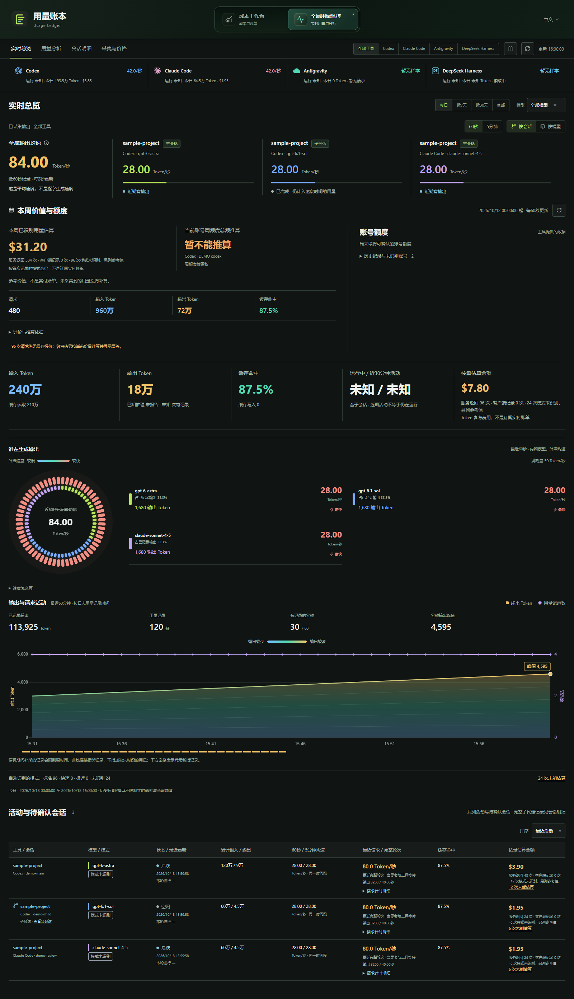
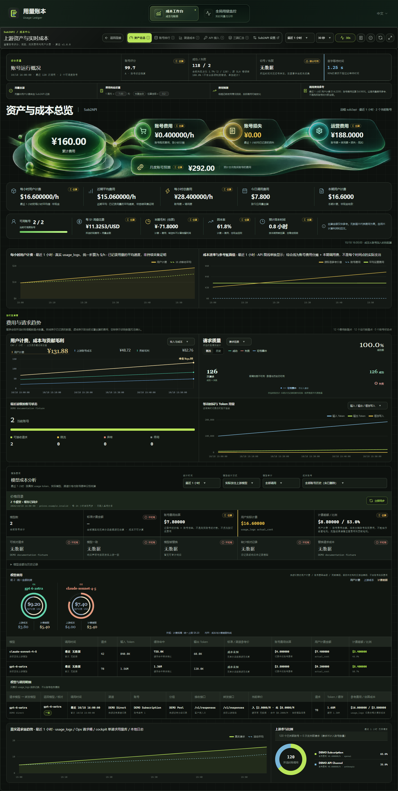

[English](README.md) | [简体中文](README.zh-CN.md)

# 用量账本

**版本 0.2.25 · AI 用量监控与成本工作台 · English / 中文**

用量账本是一款桌面应用，用于了解 AI 工具的使用情况，以及背后账号和服务的成本。它把本地用量监控与 Sub2API、CLIProxyAPI、Cockpit 的成本工作台放在同一应用中。

你可以用它：

- 比较不同工具已记录的 Token、缓存、请求与输出速率。
- 从会话追踪轮次、请求及关联的子代理。
- 按账号额度轮次查看用量，而不与自然周统计混淆。
- 对照用量参考价值、采购成本、费用、退款与损失。
- 在把总数当作完整结果之前，发现缺失记录或缺失单价。

软件计算的金额基于可取得的用量、价格与自定义成本设置，属于估算，不是服务商账单，也不是实际付款凭证。

[源码仓库](https://github.com/9holy/usage-ledger) · [English guide](README.md) · [完整配图](docs/screenshots/README.md)

## 获取应用

可从[用量账本 v0.2.25 Release 页面](https://github.com/9holy/usage-ledger/releases/tag/v0.2.25)下载：

- Windows x64 安装包：[Usage-Ledger_0.2.25_windows_x64-setup.exe](https://github.com/9holy/usage-ledger/releases/download/v0.2.25/Usage-Ledger_0.2.25_windows_x64-setup.exe)。
- macOS Apple Silicon 预览：[Usage-Ledger_0.2.25_macos_arm64.dmg](https://github.com/9holy/usage-ledger/releases/download/v0.2.25/Usage-Ledger_0.2.25_macos_arm64.dmg)。
- macOS Intel 预览：[Usage-Ledger_0.2.25_macos_x64.dmg](https://github.com/9holy/usage-ledger/releases/download/v0.2.25/Usage-Ledger_0.2.25_macos_x64.dmg)。

源码和构建来源见 Release 附带的 [BUILD-INFO.json](https://github.com/9holy/usage-ledger/releases/download/v0.2.25/BUILD-INFO.json)。仅提供手动下载；本版不提供应用内自动更新或便携 EXE。

| 平台 | 支持状态 |
| --- | --- |
| Windows 10/11，x64 | NSIS 安装包；需要 WebView2。|
| macOS 13+，Apple Silicon | 预览版；独立的原生 `arm64` DMG。macOS 13 是配置的最低版本；CI 使用 macOS 15。|
| macOS 13+，Intel | 预览版；独立的原生 `x86_64` DMG。macOS 13 是配置的最低版本；CI 使用 macOS 15。|
| Linux | 本文不提供受支持的桌面打包流程。|

macOS 目标仍为预览版。安装包使用 ad-hoc 签名，没有 Developer ID 签名或公证；默认通用构建尚未验证。macOS 13 运行行为、Finder/Dock 与完整 GUI 流程、真实账号使用尚未检查。安装与构建详情请见 [macOS 指南](docs/platforms/macos.md)。首次启动前请备份重要数据。

## 首次使用

1. 启动桌面应用，在右上角选择英文或中文。语言选择会保存；
   首次语言可能跟随系统语言。
2. 通过顶部工作区切换打开**用量监控**，查看本机工具记录。
   本地监控不要求先连接远程服务。
3. 打开**成本工作台**，选择已保存的服务、新建连接，或进入本机
   **Cockpit** 数据源。
4. 解读数值前先确认当前时间范围与来源状态。
   新安装只能显示受支持来源实际提供的数据。
5. 在适用的位置填写自己的采购与成本信息。
   默认套餐假设只是起点，不是你实际付款的确认记录。

桌面应用不捆绑 Sub2API、CLIProxyAPI、Cockpit 或成本服务后端。需要连接的外部服务必须另行安装、启动与配置。

在 Windows 上关闭主窗口会将应用隐藏到系统托盘，采集仍可继续。通过托盘菜单重新打开工作区；选择**退出用量账本**才会停止应用。

## 页面导航

| 页面 | 用途 |
| --- | --- |
| 实时总览 | 查看记录窗口内的输出速率、工具/模型活动、账号周期、额度与当前会话。|
| 用量分析 | 查看期间汇总、缓存组成、模型排行、参考金额和价格覆盖。|
| 会话明细 | 查看会话家族、子代理、轮次、单次请求、耗时和来源标识。|
| 采集与价格 | 检查发现的来源、采集错误、保留历史和模型价格目录。|
| 资产总览 | 查看账号可用性、运营费用、用量价值以及费用/请求趋势。|
| 账号排行 | 比较所选期间内的账号，并检查各自成本设置。|
| 渠道成本 | 查看账号池费用及不同来源的成本假设。|
| API 接入 | 查看来源对应的端点、客户端配置和可用诊断。|
| 三端汇总 | 在相同期间比较选中的 Sub2API、CLIProxyAPI、Cockpit 读数。|
| 成本账本 | 记录购买、续费、退款、调整和终止损失。|
| 数据管理 | 检查来源状态、历史边界以及保留/维护控制。|

不同来源并不提供完全相同的字段或管理操作。进入三端汇总不会自动连接三项服务，也不会补造缺失的数据。

| 本地用量监控 | 成本工作台 |
| --- | --- |
|  |  |

虚构 DEMO 数据。[查看全部 14 个视图的中英配图](docs/screenshots/README.md)。

## 连接数据源

### Sub2API

1. 选择**新建连接**，填写名称，类型选择 **Sub2API**。
2. 填写服务根地址，例如 `https://gateway.example.invalid`。
   这里需要 Sub2API 服务地址，不是 OpenAI 兼容的 `/v1` 推理端点。
   应用会拼接 `/api/v1`，也接受已经以 `/api/v1` 结尾的地址。
3. 选择 **Admin API Key**，或使用有相应权限账号的**邮箱与密码**。
   普通推理 API key 不能代替管理员 API key。
4. 点击**保存并连接**；若登录要求两步验证，在应用内输入验证码。
5. 除非部署确实提供独立的 economics/cost-loss 接口服务，否则将
   **独立 Cost 服务地址**留空。

**记住密码**用于登录过期后的自动重登。不希望在设备上保留密码时请取消勾选；即使不记住密码，已保存的登录仍可能保留会话令牌。远程账号权限和服务实际提供的接口决定哪些账号/成本页面可以加载。

### CLIProxyAPI

1. 启动自己的 CLIProxyAPI 实例，确保管理 API 可访问。
2. 选择**新建连接**，类型选择 **CLIProxyAPI**。
3. 填写服务根地址；留空默认使用 `http://127.0.0.1:8317`。
4. 填写实例 `config.yaml` 中原始的 `remote-management.secret-key`，
   不要填写加密/哈希后的值，也不要填写供客户端推理使用的 key。
5. 点击**保存并连接**。

管理 API 使用 `/v0/management`，以管理密钥进行 Bearer 认证。`/v1/chat/completions`、`/v1/responses` 等地址属于客户端业务接口，用途不同，不应当作管理服务地址填写。

历史明细还取决于实际存在的用量记录，包括安装相应组件后产生的受支持本机 CPA 用量数据库。管理 API 能连接，不代表历史 Token 与成本一定完整。管理页面打开的是你连接的 CLIProxyAPI 实例。

桌面应用在 Windows 和 macOS 上均通过原生 SQLite 直接读取这类可选的本机 CPA 历史库，不需要安装 Python。仅连接管理 API 不需要本机历史数据库。

### Cockpit

在连接页的**本地数据**中找到 **Cockpit**，点击**打开成本工作台**。不需要填写服务地址或管理密钥。

应用从当前用户主目录下的 `~/.antigravity_cockpit` 发现受支持的数据。**数据可用**表示本地文件能够读取，不表示 Cockpit 进程正在运行。如果来源不可用，请检查 Cockpit 的安装与实际生成的本机数据；软件不会制造替代记录。

### 切换与删除连接

使用**返回连接页**切换到另一个已保存服务。删除连接只移除本机保存的连接项，不会删除上游服务器数据。不要把密钥、密码、会话令牌或账号文件贴进 issue 或聊天。

## 本地工具记录

监控器读取 **Codex**、**Claude Code**、**DeepSeek Harness** 和 **Antigravity** 的受支持记录格式。实际能显示什么取决于所安装工具及其版本产生的记录，不代表每项指标始终可用。

下表中的 `~` 指当前操作系统用户的主目录。

| 工具 | 发现的记录 | 支持的自定义位置 |
| --- | --- | --- |
| Codex | `~/.codex/sessions` 和 `archived_sessions` | 还读取 `CODEX_HOME`，以及 Cockpit 登记的 Codex 主目录。|
| Claude Code | `~/.claude/projects` | 还读取 `CLAUDE_CONFIG_DIR/projects`。|
| DeepSeek Harness | `~/.dsh/sessions` | 设置后用 `DSH_HOME/sessions` 替代默认主目录。|
| Antigravity | `~/.gemini/antigravity/brain`、`antigravity-ide/brain`、`antigravity-cli/brain` | 仅已知本机位置，没有通用自定义路径选择器。|

请在**启动用量账本之前**设置受支持的环境变量，然后重新启动应用。应用继承的是自身进程的环境，在另一个终端随后修改变量不会影响已启动的应用。在**采集与价格**中查看实际发现的目录和状态。这些记录读取器不会改写原始工具日志。

[DeepSeek Harness 接入说明](docs/integrations/deepseek-harness.md)介绍了会话版本、压缩文件及不支持格式的报错行为。Antigravity 自动发现与本地语言服务器元数据属于尽力而为的集成，可能随工具变化；缺少元数据不等于没有活动。

## 正确理解数值

### Token、速度与单价

- 缺失的缓存或推理字段保持未知。推理 Token 不应再次加到输出总数上。
- 输出速率是记录观察窗口内的平均值，不一定等于模型瞬时流式生成速度。
- 请求指定的模型/模式与响应确认的模型/模式是不同证据。
  缺少模式确认可能导致无法确定报价。
- Codex 会话首次设置模式属于初始化，不作为轮次中途的模式切换。只有原始已提交 JSONL 前缀或已登记的 `.zst` 记录能证明初始模式时，才修正历史误分类；原始证据缺失或存在真实冲突时仍保持未知。此修正保留请求/Token 记录、已保存单价与额度周期事实。
- 请查看价格覆盖与价格来源。未匹配单价的请求仍可能有有效 Token 数；
  已报价部分的汇总不是完整账单。

### 额度与账号周期

自然周用量、订阅月用量、服务商每周额度轮次是不同视图。额度轮次跟随来源报告的重置边界，不一定是周一到周日。

百分比归零本身不能证明新轮次开始。在已确认达到 100% 的额度边界之后，额外积分用量与该轮包含额度的金额分开统计，但仍计入适用的月累计。

预测会按**同一时间戳**配对同一账号、同一周期的额度百分比与累计额度。较旧但仍有效的配对会连同时间戳保留。部分已定价金额会明确标注并计数；未定价部分显示可读原因。预测不是最终费用承诺。

### 采购成本与费率

在**成本账本**记录财务事件；在账号成本控制中设置采购金额、币种、计费周期与起算时间。保存前确认当前账号、来源及覆盖日期。

用量成本根据可取得的上游记录和软件价格/成本设置计算。已录入财务事件、分摊后的订阅费用、剩余预付、退款、损失与用量参考价值不是同一个量。来源显示的用户计费不自动等于你的采购成本。

请核对页面显示的币种、汇率、账号倍率与观察期间。手动汇率覆盖在你修改或恢复自动汇率前一直是一项假设。CLIProxyAPI 和 Cockpit 不会因为比较页面包含倍率列，就具备 Sub2API 那样的账号费率层。

**费用兜底设置**中的汇率用于美元/人民币换算，不会改变 Token 数和上游账单原值。估算倍率作用于默认套餐价及按用量参考价估算的费用；已有采购记录覆盖的期间优先使用录入金额，账号自定义采购价不再乘倍率。按量费用已有可用的上游账号成本时，也不重复乘倍率。Cockpit 提供的参考费用估算仍受倍率影响，不等于实际付款。

### 未知、部分与历史状态

**无数据**、**不可用**、**部分**、**估算**和**实测**含义不同。横杠不等于零，部分金额只包含已能计算费用的记录。账号出现在历史记录中，不代表现在仍然可用。比较数值时，请使用相同来源、账号、币种、时间范围，并留意是否有缺失记录。

## 数据与隐私

采集器读取受支持的上游日志/数据库，并保存软件自己的本地账本、采集进度和账号各轮记录。财务记录、本地来源的成本设置、连接信息和界面偏好也会本地保存；Sub2API 成本档案可以保存到远程服务器。

- Windows 的 SQLite 账本通常位于 `%APPDATA%/com.console.2api`；
  旧版/回退目录包括 `%APPDATA%/2api-console`。
- 本地成本档案 JSON 在 Windows 使用 `%APPDATA%/2api-console`；
  非 Windows 的应用账本/档案回退目录是 `~/.local/share/2api-console`。
- 设置 `CONSOLE2API_LEDGER_DIR` 会改变 SQLite 账本位置。
  不要假定所有 WebView 偏好与凭据都保存在同一目录。
- 连接存储中的密钥/密码只是**混淆，不是加密**。
  保护操作系统账号和备份；这不是凭据保险箱。
- 备份重要数据时关闭应用。不要让多个相同数据身份的应用实例并行运行，
  也不要仅为修复显示而删除数据库。

监控不会修改原始来源日志，但整个软件**不是纯只读工具**：保存 Sub2API 成本档案会更新远程账号；管理/导入操作可能修改所配置的服务或本机 Cockpit 文件。财务账本记录、本地 Cockpit/CLIProxy 成本档案也属于软件写入。

已配置服务、价格、汇率、更新和主动检查可能访问网络。上游探测或模型测试可能消耗付费额度，请有意识地使用；打开本地监控不等于同意进行付费测试。更多背景见[隐私说明](docs/PRIVACY.md)。

## 常见问题

| 问题 | 检查方向 |
| --- | --- |
| 监控为空 | 先产生受支持的工具记录，查看采集与价格，核对应用继承的主目录和环境变量。|
| 来源不可用 | 阅读具体原因：文件不存在、不支持的格式、权限不足、服务不可达不是同一种问题。|
| Sub2API 登录失败 | 检查服务地址、管理员权限/认证模式、登录是否过期及两步验证码。|
| CLIProxyAPI 返回 401/403 | 使用原始管理密钥和管理服务根地址，确认实例允许当前连接。|
| Cockpit 显示未安装 | 检查当前 OS 用户下是否存在预期本地数据；仅有进程运行还不够。|
| 成本或额度缺失 | 核对账号/轮次、观测时间、价格覆盖和来源字段，不要把未知值改成零。|
| 历史总数不一致 | 对齐期间与筛选项，检查缺失/保留历史和财务覆盖时间。|
| 浏览器预览没有本地数据 | 本地读取器需要 Tauri 桌面宿主，单独 Vite 不是完整应用。|
| 桌面本地桥接启动失败 | 检查是否已有另一应用实例占用回环服务，包括 `18765` 端口。|
| 系统提示安装包风险 | 核对来源与签名；Windows 发布者签名不同于 updater 签名，Mac 测试签名不等于公证。|

报告问题时，请提供版本、系统/架构、来源类型、观察期间、可见错误与尽可能小的脱敏示例。不要上传整个主目录、凭据文件、数据库或私人会话原始日志。公开截图前检查账号名、邮箱、密钥和服务地址。

## 从源码构建

### Windows

安装 Node.js 22 LTS 或兼容更新版本、pnpm 9.15.9、MSVC 工具链的 Rust stable、Visual Studio C++ Build Tools 和 WebView2 Runtime。

~~~powershell
git clone https://github.com/9holy/usage-ledger.git
cd usage-ledger
pnpm install --frozen-lockfile
pnpm desktop:dev
~~~

桌面开发地址为 `http://127.0.0.1:5180`。构建不生成 updater 签名产物的本地安装包：

~~~powershell
pnpm exec tauri build --config src-tauri/tauri.local.conf.json
~~~

前端输出在 `dist/`，原生可执行文件在 `src-tauri/target/release/console2api.exe`，NSIS 安装包位于 `src-tauri/target/release/bundle/nsis/`。`pnpm desktop:build` 使用常规发布配置，其 updater 产物需要维护者签名私钥。未配置 Authenticode 证书时，Windows 可能显示**未知发布者**。

### macOS 测试通道

使用 Mac、Xcode Command Line Tools、Node.js/pnpm 与 Rust。默认分支已包含 Mac 专用脚本：

~~~sh
git clone https://github.com/9holy/usage-ledger.git
cd usage-ledger
xcode-select --install
rustup target add aarch64-apple-darwin x86_64-apple-darwin
pnpm install --frozen-lockfile
pnpm desktop:test:mac
pnpm desktop:build:mac
~~~

构建脚本默认生成通用 app/DMG。[macOS 指南](docs/platforms/macos.md)还介绍单架构目标与签名限制。默认通用目标尚未验证。macOS 13 运行行为、Finder/Dock 与完整 GUI 流程、真实账号使用尚未检查。源码和构建来源见 Release 附带的 `BUILD-INFO.json`。构建工作流不会发布 GitHub Release；本版仅提供手动下载。

## 文档与许可

- [完整配图](docs/screenshots/README.md)：每种语言各 14 个视图；
  全部为虚构 DEMO 数据，不是真实账号账单。
- [DeepSeek Harness 接入说明](docs/integrations/deepseek-harness.md)。
- [macOS 构建与测试指南](docs/platforms/macos.md)。
- [0.2.25 发布说明](docs/release/0.2.25.md)。
- [隐私说明](docs/PRIVACY.md)。
- [第三方来源与许可](THIRD_PARTY_NOTICES.md)及[许可文本](LICENSES/)。

本项目**并非全项目 MIT 授权**。源自 Sub2API 的代码保留适用的 LGPL-3.0 条款；第三方图标、素材和依赖分别保留各自许可。部分素材涉及非商业/相同方式共享条款，或没有授予通用复用权。源码公开不代表每个组件都能任意商用或再授权，请在分发前阅读相关声明。
