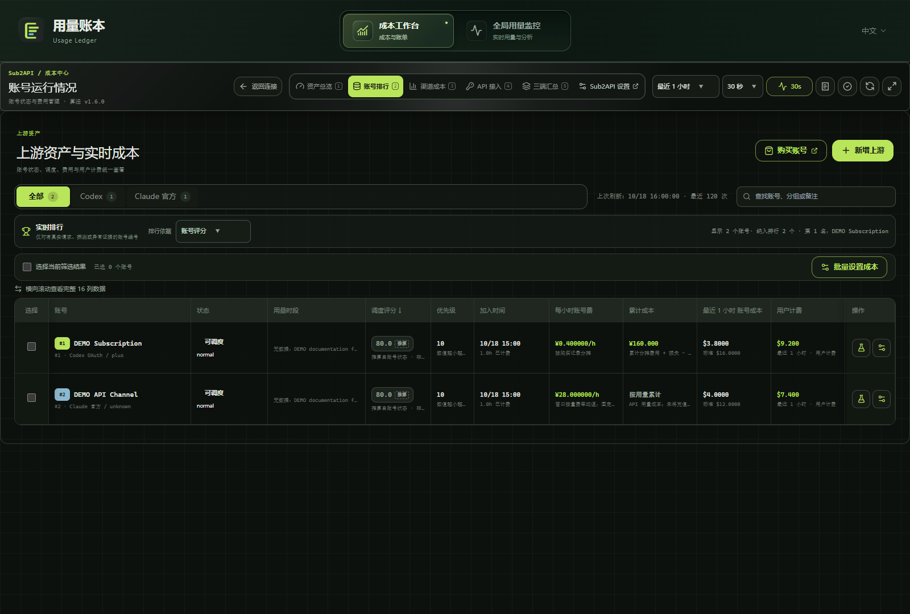
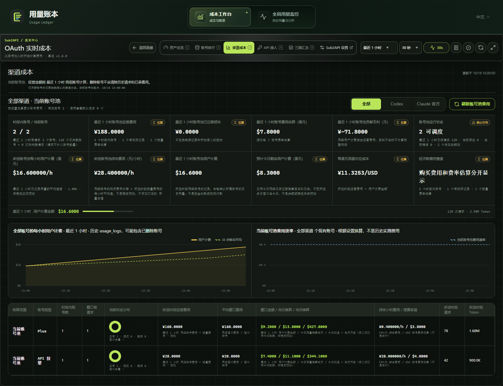

[English](README.md) | [简体中文](README.zh-CN.md)

# 用量账本

**版本 0.2.24 · Windows 桌面应用**

用量账本是一款 Windows 桌面工作区，用于查看本地 AI 工具用量、会话与子代理、模型参考费用，以及 Sub2API、CLIProxyAPI 和 Cockpit 的来源专属成本数据。应用支持中文和英文。

源码仓库：[9holy/usage-ledger](https://github.com/9holy/usage-ledger)。访问要求取决于仓库可见性。源码快照不包含 Git 历史；准备快照本身不会发布安装包，也不会更改仓库可见性。

## 工作区

| 工作区 | 内容 |
| --- | --- |
| 实时总览 | 输出速率、模型速度、请求、额度与会话 |
| 用量分析 | Token、缓存、模型排行、参考费用与价格覆盖 |
| 会话明细 | 会话、子代理、轮次、请求与耗时 |
| 采集与价格 | 采集状态与价格来源 |
| 成本工作台 | 资产、账号、渠道、API、三端汇总、财务与数据治理 |

## 支持的记录

监控器读取 Codex、Claude Code、Antigravity 和 [DeepSeek Harness](docs/integrations/deepseek-harness.md) 支持的本地记录格式。缺失、部分、推导与实测状态保持区分，不会把未知值当作零。参考费用不是服务商账单；速度、订阅额度、额外积分与时间窗口各有独立口径。

## 页面配图

| 实时总览 | 成本总览 |
| --- | --- |
|  |  |

| 上游账号 | 渠道成本 |
| --- | --- |
|  |  |

可在[截图索引](docs/screenshots/README.md)查看全部 28 个视图，每种语言各 14 个。截图展示 0.2.24 当前 Vue 组件与虚构 DEMO 数据，于 2026-10-26（Asia/Taipei）生成；演示时钟固定在 2026-10-18。截图不代表真实账号或账目核验，也不构成对费用趋势或请求质量效果的视觉验收。私人及原生应用验证截图不公开。

## 构建与运行

**工具链要求：** Windows 10/11、Node.js 22 LTS 或兼容的更新版本、pnpm 9.15.9、启用 MSVC 的 Rust stable、Visual Studio C++ Build Tools，以及 Microsoft Edge WebView2 Runtime。

解压源码快照后在其目录执行以下命令；也可在有权限时克隆仓库：

```powershell
git clone https://github.com/9holy/usage-ledger.git
cd usage-ledger
pnpm install --frozen-lockfile
pnpm exec tauri dev
```

桌面开发地址：`http://127.0.0.1:5180`。

```powershell
# 桌面前端
pnpm build:desktop

# 不生成 updater 签名产物的本地安装包
pnpm exec tauri build --config src-tauri/tauri.local.conf.json
```

也可使用 `pnpm desktop:dev`、`pnpm desktop:build`，或在 Git Bash 中运行 `bash scripts/build-desktop.sh`。前端输出：`dist/`。原生可执行文件：`src-tauri/target/release/console2api.exe`。NSIS 输出：`src-tauri/target/release/bundle/nsis/`。

源码快照不附带服务端、外部应用或插件二进制、账号、凭据或用量数据库。请在连接页配置数据源。发布 updater 需要维护者自己的签名私钥，快照不包含该私钥。本地构建配置保留现有应用数据身份；不要同时运行多个共享该身份的实例。

## 检查

```powershell
pnpm typecheck
pnpm exec vitest run src/features/desktop/__tests__/UsageEfficiencyBand.spec.ts src/views/__tests__/UsageMonitorView.spec.ts
```

`pnpm test:run` 会运行完整前端测试套件。可选的 DeepSeek Harness 后端虚构数据测试：`python scripts/test-deepseek-headless.py`（需要 Python、Cargo 和 C 编译器）。

真实本机数据诊断默认关闭并跳过。不要在公共 CI 或共享日志中设置 `USAGE_LEDGER_REAL_DATA_AUDIT=1`，也不要公开私人诊断输出。虚构测试或非空图表不能证明生产账目准确。

## 源码、隐私与许可

源码归档包含当前模块、语言文件、测试、锁文件、构建配置、图标和运行素材。导出的归档中，`SOURCE_MANIFEST.json` 列出准确文件清单。请参阅 [0.2.24 发布说明](docs/release/0.2.24.md) 和[隐私边界](docs/PRIVACY.md)。

本项目**并非全项目 MIT 授权**。源自 Sub2API 的代码和第三方素材仍受各自条款约束；请查看[第三方来源与许可](THIRD_PARTY_NOTICES.md)及 [`LICENSES/`](LICENSES/)。公开源码不代表获得每项素材的任意商业使用或再授权权利。[桌面发布记录](DESKTOP_RELEASE_NOTES.md)保留历史版本详情；旧版本说明不证明后续快照重复完成了相同检查。
